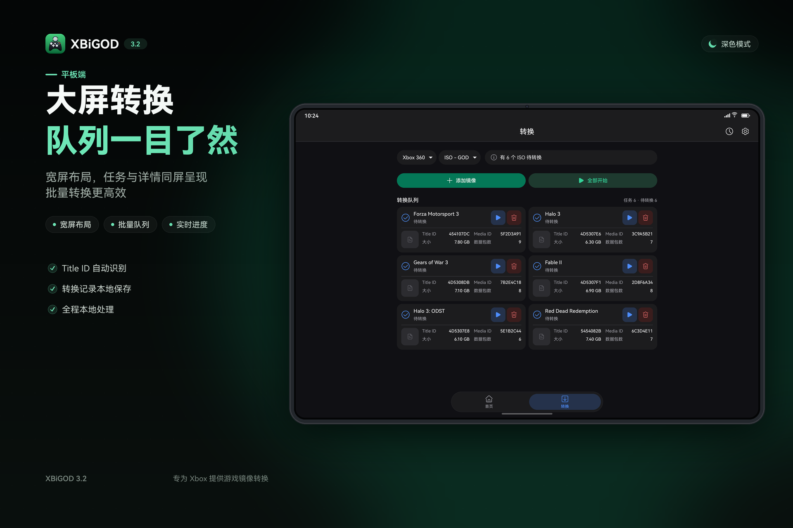
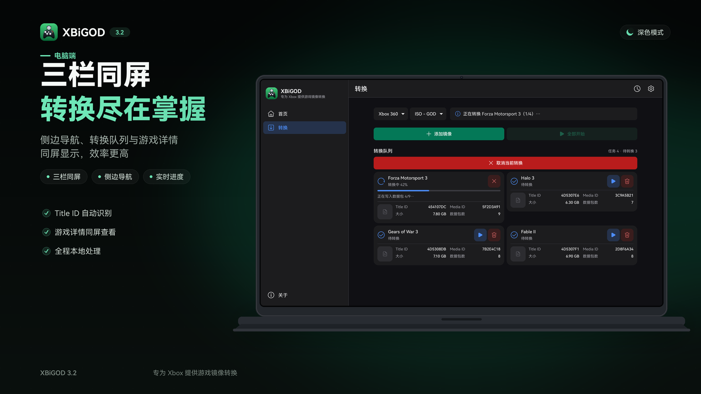

# XBiGOD

专为 Xbox 提供游戏镜像转换。在 HarmonyOS 平板与电脑上，把 Xbox 360 游戏镜像在 ISO 与 GOD 格式之间互相转换。


## 功能

- **ISO → GOD**：多任务队列、逐任务进度、单项重试与整体取消
- **GOD → ISO**：选择文件夹后自动识别头文件与 `.data`，合并导出为 ISO
- 输出统一写入「下载/XBiGOD/&lt;机型&gt;/&lt;GOD|ISO&gt;/」
- 深色模式，简体中文 / 繁体中文 / English / 日本語
- 平板、2in1 自适应布局：平板两栏，电脑侧边栏

| 平板 | 电脑 |
| --- | --- |
|  |  |

## 环境

- HarmonyOS 6.0 及以上，API 26（`compatibleSdkVersion 26.0.0`）
- DevEco Studio 6.0 及以上
- Rust 转换核心通过 NAPI 接入，OHOS 目标为 `aarch64-unknown-linux-ohos`

## 构建

1. Rust 桥接库：

   ```sh
   ./build-native.sh
   ```

2. 签名配置：复制 `build-profile.sample.json5` 为 `build-profile.json5`，在 DevEco Studio 中配置本地签名（`build-profile.json5` 已被 `.gitignore` 排除，避免提交签名口令与证书路径）。

3. 使用 DevEco Studio 打开工程构建，或执行：

   ```sh
   hvigorw assembleHap --mode module -p product=default -p module=entry@default -p buildMode=debug
   ```

## 目录

- `entry/` — HarmonyOS 应用（ArkTS UI、C++ NAPI）
- `ohos-bridge/` — Rust 转换核心与 C FFI
- `build-icon.py` — 分层应用图标生成脚本
- `store/` — 应用商店图标与宣传图

## 开源许可

XBiGOD 以 MIT 许可证开源，全文见 [LICENSE](LICENSE)。第三方组件与算法参考见 [THIRD_PARTY_NOTICES.md](THIRD_PARTY_NOTICES.md)，应用内「关于 → 开源许可」提供同样的完整清单。

| 项目 | 角色 | 许可证 | 地址 |
| --- | --- | --- | --- |
| XBiGOD | 本项目 | MIT | https://github.com/IChuJianI/XBiGOD |
| iso2god-rs | 转换引擎 | MIT | https://github.com/iliazeus/iso2god-rs |
| god2iso | GOD → ISO 算法参考 | CC BY-SA 4.0 | https://github.com/raburton/god2iso |
| iso2god-android | 行为参考（不随应用分发） | MIT | https://github.com/tkw6688/iso2god-android |

## 作者

李晨 · 3093376617@qq.com
